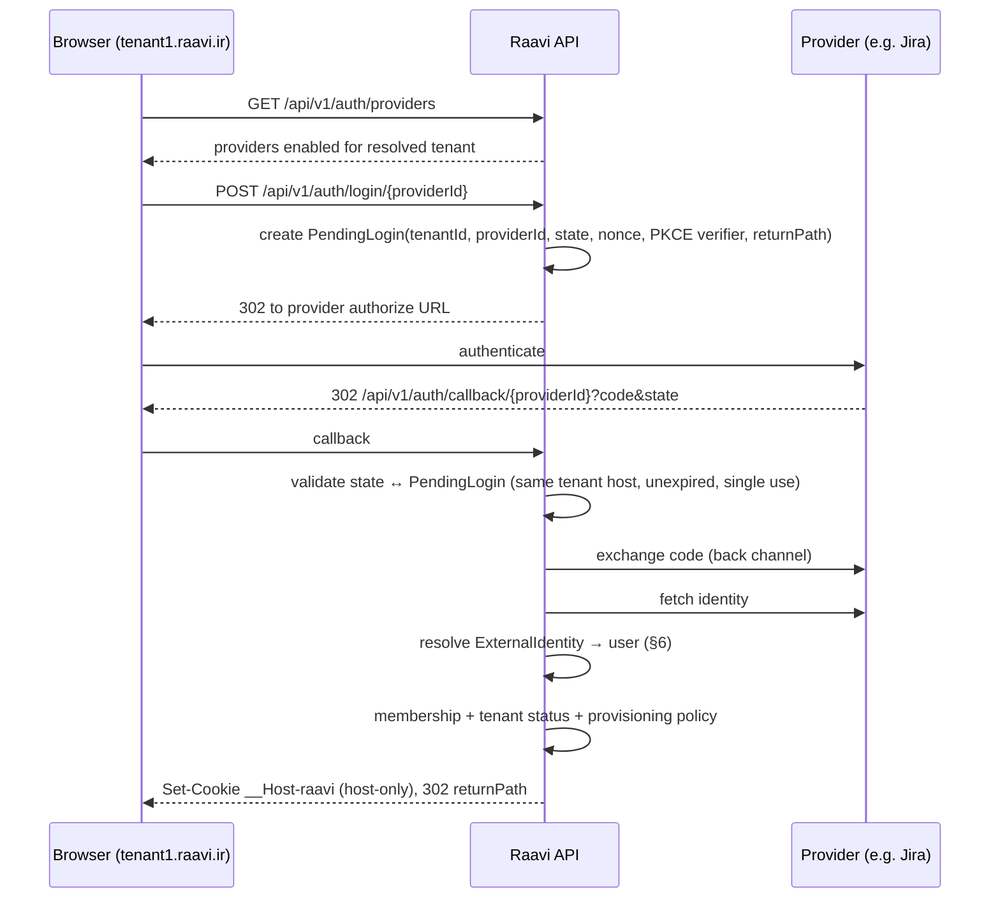

# Authentication Architecture

Three separate questions, three separate components:

| Question | Component | Source of truth |
|---|---|---|
| Who is this? (authentication) | `IAuthenticationProvider` implementations | External IdP / local credential store |
| Which tenant may they enter? (membership) | `ITenantMembershipService` | `TenantMembers` |
| What may they do? (authorization) | `IPermissionEvaluator` | Roles, groups, grants, restrictions (ADR-012) |

A successful login at any provider grants **nothing** by itself.

## 1. Providers

| Type | Flow | Stable subject key |
|---|---|---|
| Local | Credentials (password hash: ASP.NET Core Identity `PasswordHasher` PBKDF2 / upgraded to Argon2id when available), optional TOTP MFA | Raavi user id |
| LDAP | Credentials → LDAPS bind as service account, search user, bind as user | Configured attribute (`entryUUID`) |
| Active Directory | Same as LDAP (LDAPS / StartTLS mandatory) | `objectGUID` |
| OpenID Connect | Authorization code + PKCE, confidential client, nonce, `id_token` validation | `iss` + `sub` |
| OAuth 2.0 (generic) | Authorization code + PKCE; identity from a configured userinfo endpoint | Configured claim |
| Jira Data Center | See §5 and ADR-007 | Jira user `key` |
| Plugin | Implements `IAuthenticationProvider`; runs in-process only if signed and trusted (ADR-015) | Provider-defined |

## 2. Configuration split

- **Global** (`sandbox/config/identity-providers.json`): the list of provider definitions with endpoints, client ids, service accounts. Secrets are referenced from environment variables / secret store, never stored in the file. Tenant admins cannot see or change these.
- **Tenant** (SQL Server `identity.TenantAuthenticationProviders`): for each global provider — enabled?, display order, default?, display name override, provisioning mode, allowed e-mail domains, allowed external groups, group→role mapping, require MFA (local). Changes are audited (`SecurityEvents`).
- A tenant can only narrow (e.g. disable local login, require group membership), never widen global policy.

## 3. Provider contract (code: `Raavi.Identity/Providers/IAuthenticationProvider.cs`)

Each provider exposes: `ProviderId`, `Type`, `SupportedFlows`, `ValidateConfiguration()`, `TestConnectionAsync()`, `BeginRedirectAsync()`, `CompleteRedirectAsync()`, `AuthenticateWithCredentialsAsync()`, and returns a verified `ExternalIdentity(ProviderId, SubjectId, Username, Email, EmailVerified, DisplayName, Groups)`. Health is reported via `ProviderHealth` and surfaced in system admin and `/health/ready` (degraded, not failed, when an optional provider is down).

`IAuthenticationProviderRegistry` builds providers from global definitions at startup (validated; invalid definitions fail startup in Production). No central service with `switch (providerType)` branches exists — each provider is its own class registered by type.

## 4. Login flow

- `PendingLogin` is stored server-side (Redis, 10 min TTL) — state is an opaque random value, not a signed blob containing the tenant.
- Callback URL is always on the same tenant host that started the flow; providers are registered with each base-domain wildcard or per-domain callback as their capabilities allow (documented per provider). Where a provider supports only one fixed callback URL, the callback lands on the system host's `/auth/relay` which validates the `PendingLogin` and performs a one-time-code hand-off back to the tenant host (code bound to tenant + browser via a separate nonce cookie, 60 s TTL).
- `returnPath` must be a local path (no scheme, no `//`, no backslash).
- Login failures return a generic error; the specific reason goes to `SecurityEvents`.

## 5. Jira authentication (summary of ADR-007)

Order of preference, chosen per Jira instance after inspecting its version and configuration:

1. **Shared enterprise IdP** — if Jira already authenticates through SAML/OIDC (e.g. Atlassian Data Center SSO with AD FS/Keycloak/Entra ID), Raavi integrates with *that IdP* via OIDC. This is the most robust option; the Jira provider is then used only for user/group lookups.
2. **Jira Data Center OAuth 2.0 provider** (Jira DC 8.22+; incoming application link): authorization code grant (+ PKCE where supported) with scope `READ`; identity from `GET /rest/api/2/myself` (`key`, `name`, `emailAddress`, `displayName`). Subject key = user `key` (stable across renames). Token is used once for identity and then discarded unless the tenant also enables the Jira integration.
3. **OAuth 1.0a application link** (older Jira versions): RSA-SHA1 three-legged flow, same identity call.
4. **Not supported:** forwarding the user's password to Jira (`/rest/auth/1/session`, Basic auth) or scraping Jira session cookies.

Jira e-mail is treated as **unverified** by default (`TrustEmail: false`), because Jira administrators can set arbitrary e-mail addresses.

All endpoints, client id, scopes and mode come from the global provider definition — no Jira URL is hardcoded.

## 6. External identity mapping and account linking

- Identity key = `(AuthenticationProviderId, ExternalSubjectId)`, unique in `identity.ExternalIdentities`.
- Lookup is by key only. E-mail matching is **never** used to silently attach a new external identity to an existing user.
- Linking an additional identity to an existing account requires the user to be signed in to the existing account (or to have proven control of it through a verified e-mail challenge sent by Raavi) and then complete the new provider login; both events are audited and the user is notified on all linked channels.
- Collision handling: if a new identity's verified e-mail equals an existing user's e-mail, provisioning is held for administrator approval or the user is asked to sign in with the existing account first — never merged automatically.

## 7. Provisioning policies (per tenant + provider)

`ExistingUsersOnly`, `AutomaticCreation` (optionally restricted by e-mail domain and/or external group), `AdministratorApproval` (creates a pending membership request). Group-based provisioning maps external groups (LDAP/AD/OIDC claims, Jira groups) to tenant groups/roles; mappings are re-evaluated on each login and can be synchronized by a scheduled job.

## 8. Sessions and tokens

- Browser: server-side session (ticket stored in Redis/SQL, cookie holds only an opaque id), `__Host-raavi` host-only cookie, idle + absolute timeouts from `authentication.json`, rotation on privilege change, revocation list on logout/password change/membership removal/tenant suspension.
- CSRF: SameSite=Lax + anti-forgery token header (`X-XSRF-TOKEN`) required on all state-changing requests from the SPA.
- API tokens (personal/service): hashed at rest, scoped to one tenant, with explicit scopes and expiry; sent as `Authorization: Bearer`.
- Collaboration tickets: see ADR-011 (≤ 60 s, single document, signed ES256).
- System administrators: local account or dedicated IdP, MFA required, only usable on the system host. **Phase 1 bootstrap:** operator API keys (only SHA-256 hashes configured, accepted only on the system host, constant-time compare, audited as `apikey:<id>`) — see `docs/api/TENANCY_API.md`. They remain available for automation after Phase 2.

## 9. Implementation status (Phase 2a, 2026-11-06)

Implemented and tested: provider registry (fails fast on enabled-but-unavailable types), local provider (PBKDF2 hashes, lockout 5 failures / 15 min, timing equalization), tenant provider policies (implicit "local only" default), server-side sessions (SHA-256-hashed opaque token, host-only cookie, idle 60 min / absolute 12 h, security-stamp invalidation, revocation on logout / suspension / removal, session-fixation protection), membership + TenantAdministrator role, groups, invitations (hashed token, link with the token in the URL **fragment**, single use, 72 h), system administrators with mandatory RFC 6238 TOTP (replay-protected), antiforgery on every state-changing cookie request including login, login rate limiting, tenant and system security events.

Design notes and known limitations:
- **Invitation non-disclosure residual risk:** the API response to the inviting admin is identical for existing and new addresses, but until e-mail delivery exists (notifications, Phase 7) the admin receives the link and could learn from the accept page whether the address already has an account. Once links are e-mailed, only the mailbox owner sees that page.
- Session validation is cached for at most 30 s (L1 at most 15 s); revocation evicts the entry on the revoking node immediately; other nodes converge within the L1 lifetime.
- **Tenant switching** (listing all tenants a user belongs to) is not implemented: memberships are RLS-protected per tenant. Planned with a global, non-sensitive membership index in Phase 2b.
- **Development over plain http:** `Raavi:Authentication:Session:AllowInsecureHttp` (set in `authentication.Development.json`) drops the `__Host-` prefix and the `Secure` flag so `http://*.raavi.localhost` works. Options validation refuses to start with it outside the Development environment (tested). Tests always run the strict mode.
- External providers (OIDC, LDAP/AD, Jira), external identity linking, group sync and the callback relay are Phase 2b.

## 9b. Implementation status (Phase 2b, 2026-11-06)

Implemented and tested with in-process fakes (OIDC provider, Jira DC, LDAP directory):
- **Redirect flow** (`ExternalLoginFlow`): `POST /auth/login/{id}/begin` (antiforgery) → pending login in the distributed cache keyed by SHA-256(state), single-use, 10 min, binding tenant, provider, PKCE verifier, nonce, safe return path, mode (sign-in/link) and the hash of a host-only browser-binding cookie (`__Host-raavi-login`, SameSite=Lax) → provider → callback on the tenant host (`PerHost`) or on the system host (`Relay`, then a one-time 60 s hand-off code to the tenant host). Tenant, provider and browser are re-checked on the tenant host; errors are returned as `/login?error=<code>` only.
- **OIDC**: discovery + JWKS, code + PKCE + nonce, id_token signature/issuer/audience/lifetime validation, configurable claims, `email_verified` honoured unless `TrustEmail`.
- **Jira DC**: see ADR-007 outcome.
- **LDAP/AD**: LDAPS or StartTLS required, RFC 4515-escaped filters, service-account search then user bind, empty passwords rejected before any bind, subject `objectGUID`/`entryUUID`, groups from `memberOf` CNs. Real directory access (System.DirectoryServices.Protocols) is **not** integration-tested (no directory server available); provider logic is tested against a fake.
- **Identity mapping & provisioning**: (provider, subject) only; ExistingUsersOnly / AutomaticCreation / AdministratorApproval; never merges by e-mail (`auth.account_link_required`); unverified external e-mail is stored as contact only, never as sign-in address; domain gate requires verified e-mail; group gate on every sign-in; allowed groups mirrored as tenant groups (`{group} ({provider})`) and membership synchronized at each sign-in.
- **Account linking**: signed-in user links via the same flow (mode Link, bound to the session user); identities already linked to someone else are refused; unlink keeps at least one sign-in method.
- **Tenant switching**: global, non-authoritative `[identity].UserTenantMemberships` index maintained in the same SaveChanges as every membership change (backfilled by migration); `GET /auth/me/workspaces` lists only the caller's active memberships in active tenants.
- Tenant provider policies: `PUT` replaces the whole set (omitted providers are disabled — fixed during 2b testing); admin UI with connection test.

Still open: verification against the customer's Jira (Q1) and real AD/LDAP; OAuth 1.0a Jira links (not planned); SAML (via an OIDC-capable IdP bridge).

## 10. Audit

`SecurityEvents`: login success/failure (provider, reason code, IP, user agent), MFA events, account linking, provisioning decisions, provider configuration changes, tenant provider policy changes, session revocations. Never logs passwords, codes, tokens or secrets.
