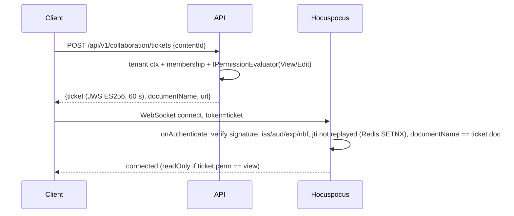

# Collaboration Architecture

## 1. Components

| Component | Technology | Role |
|---|---|---|
| Client | Tiptap 3 + `@tiptap/extension-collaboration` + `@tiptap/extension-collaboration-caret` + `@hocuspocus/provider` + `y-indexeddb` (offline cache) | Edits a Yjs doc; shows presence/cursors |
| Collaboration server | `@hocuspocus/server` (Node.js LTS) + `@hocuspocus/extension-redis` | Sync, awareness, auth hook, persistence hook |
| Raavi API (internal endpoints) | ASP.NET Core | Ticket issuing, permission checks, durable persistence, publishing |
| Redis | | Cross-node pub/sub for Hocuspocus, revocation events |
| SQL Server | | `CollaborationDocuments`, `YjsUpdates`, `CollaborationSnapshots` metadata, `CollaborationSessions` |
| Object storage | | Large snapshots (> 256 KB) |

## 2. Document identity

Collaboration document name = `{tenantId}:{contentType}:{contentId}:draft` (e.g. a page draft). The name is an **address**, never an authorization token.

## 3. Ticket flow

Ticket claims: `sub` (user id), `tid` (tenant id), `doc` (document name), `perm` (`edit`/`view`), `sid` (session id), `jti`, `iat`, `nbf`, `exp` (≤ 60 s), `aud=raavi-collaboration`. Signing key: ES256 private key on the API (mounted secret), public key distributed to Hocuspocus via config. Tickets are single-use (jti replay cache).

On reconnection the client requests a new ticket (the provider's `token` callback fetches one), so permission is re-evaluated on every connect.

## 4. Revocation and downgrade

- Permission, membership, session or tenant-status changes publish `collab.revoke {tenantId, scope: user|content|space|tenant, ids}` on Redis.
- Hocuspocus nodes subscribed to the channel close affected connections (code `4403`) or switch them to read-only after re-checking with the API (`POST /internal/collaboration/check`).
- Additionally each connection is re-validated every `PermissionRecheckSeconds` (default 60).

## 5. Persistence

- Hocuspocus `onStoreDocument` (debounce 2 s, max 10 s) sends the **incremental update** (`Y.encodeStateAsUpdate(doc, lastStoredStateVector)`) to `POST /internal/collaboration/{doc}/updates` with service authentication (mTLS or a rotated shared HMAC key — configured in `collaboration.json`). The API validates tenant/document and appends a row to `YjsUpdates` (TenantId, DocumentId, Seq, Bytes, ClientIds, CreatedAt).
- Every `SnapshotEveryUpdates` updates (default 500) or on last client disconnect, a full snapshot (`Y.encodeStateAsUpdate(doc)`) is written (inline or object storage) and older updates are compacted (deleted after the snapshot commit).
- `onLoadDocument` fetches latest snapshot + subsequent updates from the API.
- Crash recovery: updates are acknowledged to clients by Yjs sync; the server persists after debounce. Clients keep unsynced updates in IndexedDB and re-send on reconnect, so acknowledged-but-not-persisted updates are recovered from any reconnecting client. Target: no loss of updates acknowledged by persistence; bounded window (≤ max debounce) for updates acknowledged only by sync if **all** clients and the server crash simultaneously — documented limitation.
- Retention: compacted updates are removed; snapshots older than the retention policy (except those referenced by published versions) are deleted by a retention job.

## 6. Collaboration history vs published versions

| | Collaboration history | Published version history |
|---|---|---|
| Stored as | Yjs updates + snapshots | `PageVersions.ContentJson` (Document JSON) |
| Granularity | Keystroke-level, compacted | Explicit publish / manual save / restore / import |
| Visible to users | "Draft activity" (optional, for editors) | Version history UI, compare, restore |
| Retention | Short (policy) | Permanent unless content deleted |

Publishing: API asks Hocuspocus (or loads the persisted state itself using the .NET Yjs-compatible decoder — decision in Phase 6 spike; default: Node side converts `Y.XmlFragment → ProseMirror JSON` via `y-prosemirror` and posts it) → API validates against the editor schema → creates `PageVersion` (`VersionType=Published`) inside a transaction → outbox events (search, notifications, automation).

Restoring an old version replaces the draft Y doc content in a single transaction-like operation (new Yjs update generated server-side from the JSON) and is broadcast to connected editors.

## 7. Undo/redo, presence, offline

- `Y.UndoManager` via Tiptap collaboration extension — per-user undo of own changes.
- Awareness: user id, display name, avatar URL (served via API), color; no e-mail.
- Offline: `y-indexeddb` caches drafts locally (keyed by tenant + document; cleared on logout); on reconnect a fresh ticket is obtained and updates merge.

## 7b. Implementation notes (Phase 6)

- Document name: `{tenantId}:page:{contentId}:draft`; tables `content.CollaborationDocuments`, `CollaborationUpdates` (seq per document), `CollaborationSnapshots` (compaction deletes covered updates after the snapshot commit).
- Internal endpoints: `GET /internal/collaboration/jwks`, `GET …/documents/{name}/state` (snapshot + later updates, or a JSON seed from the draft/published version on first load), `POST …/updates` (`{update, json, contributors}`), `POST …/snapshot` (`{state, seq}`), `POST /internal/collaboration/check`. Signature header `X-Raavi-Signature: t=…,s=…` (HMAC-SHA256 over time, method, path+query and the SHA-256 of the body; 60 s window). These paths must not be published by the reverse proxy.
- Collaboration server endpoints for the API: `POST /internal/flush`, `/internal/reset`, `/internal/recheck` (same signature).
- Close reasons: `raavi:revoked` (client stops, shows a notice) and `raavi:reset` (client clears its IndexedDB cache, then re-joins).
- Real-time editors publish with `If-Match: *` and save the title through `PUT /content/{id}/draft/title`.

## 7c. Whiteboards (Phase 11c, ADR-035)

Boards are a second document kind: name `{tenantId}:board:{boardId}:live`, Yjs `elements` (map of per-element maps) + `order` (array), edit-only tickets, full-state persistence on the board row (no update log or snapshots), validation by the same rules as a REST save, reset on refusal or on a whole-board save.

## 8. Limits and observability

Max document size (default 20 MB Y state), max connections per document (default 200), message rate limits per connection. Metrics: active documents, connections, reconnects, persistence latency/failures, revocations, ticket rejections (by reason).
