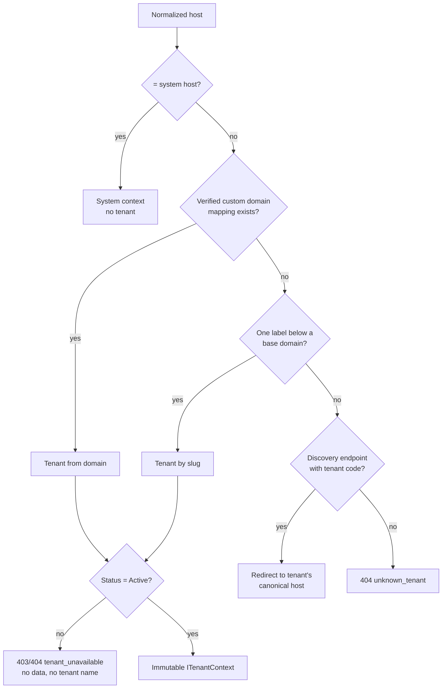

# Multi-Tenant Architecture

Multi-tenancy is a foundation, not a feature: every tenant-owned table, cache key, search document, object key and job is tenant-aware from its first migration.

## 1. Tenant model

| Field | Rules |
|---|---|
| `Id` (uniqueidentifier) | Internal, immutable. The **only** value used in relationships and authorization. |
| `Code` | Unique, immutable by default, `^[A-Z][A-Z0-9]{2,15}$` (e.g. `T001`). Human/operator facing, used in onboarding and support. Never a security boundary. |
| `Slug` | Unique within the base-domain namespace; a single DNS label `^[a-z0-9](?:[a-z0-9-]{0,61}[a-z0-9])$`, length ≥ 2, not `xn--…`, not in the reserved list (`admin`, `api`, `collab`, `www`, `static`, `mail`, `auth`, `login`, `status`…). Changeable only by a system administrator; old slug is kept as a redirect for a grace period and cannot be reused by another tenant during it. |
| `DisplayName` | Localizable (fa/en). |
| `Status` | `Provisioning`, `Active`, `Suspended`, `Deactivated`, `PendingDeletion`, `Deleted`. Only `Active` serves normal traffic. |
| `CreatedAt`, `ActivatedAt`, `SuspendedAt`, `SubscriptionEndsAt?` | UTC. |
| Settings, branding, quotas, provider policies | Separate typed tables (see `DATABASE_DESIGN.md`). |

Users are **global identities**; tenant access comes from `TenantMembers`. One person can belong to several tenants and switch between them; each tenant sees only its own members (a tenant admin cannot discover that an e-mail exists in another tenant — inviting an existing identity sends an invitation that the user must accept).

## 2. Tenant addressing

| Method | Example | Use |
|---|---|---|
| Subdomain of a configured base domain | `tenant1.raavi.ir` | Default for every tenant (`slug.{baseDomain}`) |
| Verified custom domain | `wiki.company1.com` | Optional; one primary + additional verified domains |
| Tenant code | `T001` | **Only** on discovery endpoints (login discovery, onboarding) on the system host; results in a redirect to the tenant's canonical host — never establishes a tenant context for data access |
| System host | `admin.raavi.ir` | System administration only; never resolves to a tenant |

Base domains and the system host are global configuration (`Raavi:Hosting`). Custom domains are tenant data (`system.TenantDomains`).

## 3. Host normalization (implemented: `Raavi.Tenancy/Resolution/TenantHost.cs`)

Input is the Host after forwarded-header processing (accepted only from configured proxies). Rules:

1. Trim; reject empty.
2. Reject bracketed/IPv6 literals; strip a numeric port (1–65535), reject malformed ports.
3. Remove a single trailing dot; reject empty labels (`a..b`).
4. Convert IDN to ASCII (punycode) with STD3 rules; lower-case invariant.
5. Reject IP literals and digit-only hosts.
6. Each label 1–63 chars of `[a-z0-9-]`, not starting/ending with `-`; total ≤ 253.

Subdomain parsing accepts **exactly one label** below a base domain (`a.b.raavi.ir` is rejected, not interpreted as `a` or `b`).

## 4. Resolution precedence (ADR-004)

- Conflicts are rejected: a request whose host resolves to tenant A while a route/explicit identifier names tenant B → `400 tenant_conflict` (logged as a security event).
- No HTTP header other than Host (after trusted proxy processing) influences resolution. `X-Tenant-Id`-style headers are ignored and logged if present.
- Resolution results are cached in memory + Redis (`sys:host:{host}` → tenantId/status) with short TTL and explicit invalidation on domain/status change. Suspension takes effect within one cache TTL at worst (target ≤ 30 s) and immediately on the node that performed it; sessions are additionally checked against tenant status on each request.
- Unknown/inactive tenants return a generic page that does not reveal whether the tenant exists.

## 5. Custom domains

1. Tenant admin adds `wiki.company1.com` → status `PendingVerification`, a random token is issued.
2. Admin publishes DNS TXT `_raavi-verify.wiki.company1.com = raavi-verify=<token>` (prefix configurable in `security.json`).
3. Verification job checks via DNS (system resolver), marks `Verified`; only verified domains resolve.
4. Uniqueness is global (one domain → one tenant); a domain previously used is quarantined for a period after removal.
5. Re-verification runs periodically; failure moves the domain to `VerificationLost` after a grace period (alerts tenant admins).
6. TLS for custom domains is provided by the operator's reverse proxy/certificate process (ACME on-demand or customer certificates) — documented in `DEPLOYMENT_GUIDE.md`.

## 6. Cookies and sessions across hosts

Session cookies are **host-only** (`__Host-` prefix, no `Domain` attribute, `Secure`, `HttpOnly`, `SameSite=Lax`). A cookie issued on `tenant1.raavi.ir` is never sent to `tenant2.raavi.ir` or to a custom domain. Tenant switching navigates to the other tenant's host and signs in there (silent SSO through the identity provider where available). The session also stores the tenant id it was issued for and is rejected on any other tenant.

## 7. Tenant lifecycle

| Operation | Behaviour |
|---|---|
| Create | System admin; assigns Code (immutable), Slug, initial admin invitation; status `Provisioning` → `Active` after seed (default roles, groups, settings). |
| Suspend | Immediate: resolution cache invalidated, active sessions and collaboration connections closed, jobs for the tenant paused (not deleted). Data untouched. |
| Deactivate | Like suspend, plus scheduled jobs cancelled; reversible. |
| Export | **12a (ADR-037): on-demand ZIP (JSON + attachments) of what the requesting administrator may view, built in a temporary file and streamed; no stored archive. The background-job/object-storage variant and a full-tenant dump by the installation administrator are still open.** |
| Delete | Two-step: request (reason, audited) → `PendingDeletion` with retention window → irreversible purge job that deletes tenant rows in dependency order, object-storage prefix, search documents and Redis keys, then writes a deletion certificate to the system audit log. Requires a second system administrator to confirm. |
| Quotas & usage | Storage bytes, users, spaces, AI tokens tracked per tenant (`TenantUsage`), enforced at write time. |

## 8. Branding

Logo, favicon, application name (if allowed by global policy), primary/secondary color, login page background and welcome message. Colors are validated hex values applied as CSS custom properties; images are re-encoded raster files (SVG rejected); welcome message is sanitized rich text. **Custom CSS is disabled by default**; if enabled globally it is restricted to a validated allow-list of properties, parsed server-side, and served from a separate stylesheet with a CSP that forbids `url()` to external origins and any script. No tenant branding can execute scripts.
