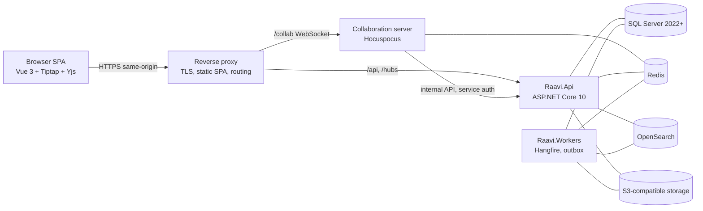

# System Architecture

Raavi is a multi-tenant, fully on-premises enterprise wiki. It is built as a **modular monolith** (one ASP.NET Core API process and one worker process sharing the same modules) plus a **dedicated collaboration server** (Hocuspocus/Yjs on Node.js).

## 1. Runtime topology

| Process | Responsibility | Scales |
|---|---|---|
| Reverse proxy | TLS termination, tenant host routing, serves SPA assets, forwards `X-Forwarded-*` | Horizontally |
| `Raavi.Api` | REST `/api/v1`, SignalR hubs, authentication, tenant resolution, authorization, collaboration ticket issuing, internal endpoints for the collaboration server | Horizontally (stateless; Data Protection keys shared; SignalR Redis backplane) |
| `Raavi.Workers` | Hangfire jobs: outbox dispatch, search indexing, attachment processing, notifications, scheduled publishing, automation, Confluence import, retention | Horizontally (Hangfire queues) |
| Collaboration server | Yjs document sync, awareness/presence, batched persistence via the API | Horizontally (Redis extension; sticky sessions per document recommended) |

No mandatory external cloud dependency exists. AI providers are optional and can be local models.

## 2. Logical architecture

Layers inside the monolith (dependency direction is inward, enforced by tests — see `MODULE_BOUNDARIES.md`):

- **Domain** — entities, value objects, invariants, domain events. No framework dependencies.
- **Application** — use cases (commands/queries), DTOs, validation, cross-cutting abstractions (`ITenantContext`, `ICurrentUser`, `IPermissionEvaluator`, `IContentProvider`, `IClock`).
- **Infrastructure** — shared technical infrastructure: EF Core base context and interceptors, SQL Server, Redis, object storage, e-mail, Hangfire, configuration, HTTP foundation.
- **Feature modules** — Tenancy, Identity, Migration, Search, AI, Integrations: vertical slices with their own domain/application/infrastructure folders and their own DbContext/schema.
- **Hosts** — Api and Workers are composition roots only.

The core wiki (spaces, content, versions, comments, permissions, media, collaboration metadata, templates, tasks, calendar, databases, whiteboards, workflows, automation, notifications) lives in Domain/Application/Infrastructure namespaced by bounded context. Bounded contexts may be extracted into their own module projects when they grow; the namespace boundaries are already enforced by convention and review.

## 3. Request pipeline (API)

1. Forwarded headers (only from `Raavi:Hosting:KnownProxies/KnownNetworks`).
2. Correlation id.
3. Exception handler → RFC 9457 problem details.
4. HSTS (non-development), security headers.
5. **Tenant resolution** (Phase 1) → immutable `ITenantContext`, or system-host context, or 404 rejection.
6. Rate limiting (per tenant + per user/IP).
7. Authentication (host-only session cookie).
8. **Tenant membership gate** — an authenticated user without active membership in the resolved tenant is treated as anonymous for that tenant.
9. Authorization (endpoint policies + resource checks through `IPermissionEvaluator`).
10. Endpoint.

## 4. Data stores

| Store | Purpose | Tenant isolation |
|---|---|---|
| SQL Server | System of record: tenants, identity, content, versions, ACL, jobs, outbox, Hangfire | `TenantId` on every tenant-owned row, EF filters, RLS (defence in depth) — `TENANT_ISOLATION.md` |
| Redis | Cache, SignalR backplane, Hocuspocus coordination, distributed locks, rate-limit counters | Keys prefixed `t:{tenantId}:` |
| OpenSearch | Full-text + vector search | `tenantId` field + routing + mandatory filter |
| S3-compatible storage | Attachments, collaboration snapshots, exports, import archives | Keys prefixed `tenants/{tenantId}/` |

## 5. Cross-cutting concerns

- **Outbox** — domain changes that must reach search, notifications, automation or webhooks are written to `IndexingOutbox`/`Outbox` in the same transaction and dispatched by workers (at-least-once; consumers are idempotent).
- **Auditing** — security events (`SecurityEvents`) are separate from user activity (`ActivityLogs`).
- **Observability** — structured JSON logs, OpenTelemetry traces/metrics, health/readiness/liveness endpoints (ADR-018).
- **Localization** — Persian and English from day one, RTL/LTR, Jalali/Gregorian (ADR-022).

## 6. Configuration model

Two categories, strictly separated:

| | Global configuration | Tenant configuration |
|---|---|---|
| Scope | All tenants / the installation | One tenant |
| Location | `sandbox/config/*.json` + environment variables + secret store | SQL Server (`tenancy.TenantSettings`, `TenantDomains`, `TenantAuthenticationProviders`, branding, quotas…) |
| Edited by | Operators (deployment) | Tenant administrators via UI/API (audited) |
| Examples | Connection strings, Redis/OpenSearch/S3 endpoints, SMTP, global identity provider definitions (Jira A/B, AD, OIDC), security policies, feature availability | Display name, slug, domains, branding, locale/time zone, enabled providers and provisioning policy, quotas, retention, AI settings where allowed |

Loading order for global configuration (implemented in `Raavi.Infrastructure/Configuration/SandboxConfiguration.cs`): `appsettings.json` → `appsettings.{Env}.json` → module files (`authentication`, `identity-providers`, `storage`, `search`, `collaboration`, `security`, `feature-flags`) and their `{Env}` variants → `RAAVI_*` environment variables → command line.

Rules:

- `sandbox/` is never inside a web root (the loader refuses it) and is mounted read-only in containers.
- Files contain **no production secrets**; secrets come from environment variables or the platform secret store (Kubernetes secrets, Docker secrets, Vault). Placeholders read `__SET_VIA_ENV_OR_SECRET_STORE__`.
- Tenant configuration is typed, versioned, validated records — not one free-form JSON blob. JSON columns are allowed only for genuinely extensible settings, with a schema version and validation.
- Tenant settings can only *narrow* global security policy, never widen it (e.g. a tenant may require MFA; it can never disable the global lockout policy).

## 7. Technology baseline

As mandated by the product specification: ASP.NET Core 10, Vue 3 + TypeScript, PrimeVue, SQL Server 2022+, Tiptap 3, Yjs, Hocuspocus, SignalR, Redis, OpenSearch, S3-compatible object storage (MinIO by default), Hangfire, Mermaid, Monaco, Konva.js/Fabric.js (evaluation in Phase 9), Docker Compose and Kubernetes. Licensing risks and mitigations are in `DEPENDENCY_AND_LICENSING.md`.
