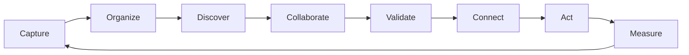

# Product Vision — Raavi as an Enterprise Knowledge Operating System (EKOS)

**Date:** 2026-11-11  
**Stage:** A (assessment & target design — no production code in this stage)  
**Outcome desired:** Raavi becomes the intelligent operating system for organizational knowledge — not a larger wiki, not ERP/CRM/BPM.

## Positioning

| Raavi is | Raavi is not |
|----------|--------------|
| On-prem, multi-tenant knowledge & collaboration layer | Generic project management / ERP / CRM |
| Source of truth for pages, relationships, Raavi-native records | Source of truth for Jira issues, external calendars, Templar analytics |
| Connector between people, documents, systems, decisions | A second Jira or incident-management product |
| AI-assisted discovery and maintenance of knowledge | An unconstrained autonomous agent platform |

## Value loop

1. **Capture** — people, documents, meetings, integrations  
2. **Organize** — spaces, taxonomy, relationships, asset types  
3. **Discover** — hybrid search, AI ask, graph navigation  
4. **Collaborate** — co-edit, comments, meetings, tasks  
5. **Validate** — ownership, review, approval, classification  
6. **Connect** — Jira, Templar, identity, calendars (authoritative externals stay external)  
7. **Act** — knowledge workflows, action items, decisions  
8. **Measure** — coverage, freshness, search/AI usefulness (not vanity views alone)

## Design principles (binding)

1. **Evolve, do not rewrite** — modular monolith (`Raavi.Wiki` / `AI` / `Integrations` / …); preserve data and URLs where practical.  
2. **Reuse before invent** — Labels, Calendar, Prompt Hub, WikiAuthorizer, outbox, RAG stay the spine.  
3. **No second frameworks** — one authz path, one search ACL filter (`IViewableContentFilter`), one tenant context.  
4. **Relational graph first** — SQL relationship edges before any graph DB.  
5. **AI is permission-bound** — never more access than the user (or explicit service identity).  
6. **On-prem first** — sandbox config, no cloud-only dependencies for core paths.  
7. **Incremental delivery** — Stage B only after product-owner approval of Stage A.

## Success (Definition of Done — product)

Coherent knowledge UX; lifecycle + governance; secure unified search; AI with sources; integrations without stealing SoT; analytics that drill to authorized records; multi-tenant isolation intact; existing installations migratable.