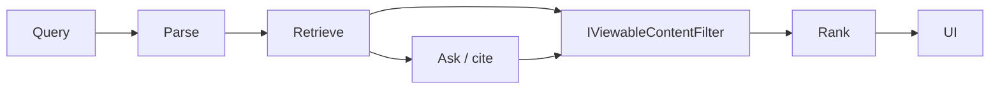

# Search and Discovery Architecture

## Current

| Path | Behavior |
|------|----------|
| Quick-find | SQL title/space; viewable spaces then FilterViewable |
| Labels search | ContentLabels + AND/OR + descendants; view filter |
| Smart search / Ask | `ai.Chunks` keyword + optional embeddings RRF; **query-time** ACL |
| OpenSearch | Deferred (ADR-013 / Phase 7c); config stub |

## Target unified experience

Single Search UI composing:

1. Text / semantic hybrid (existing RAG → later OpenSearch hybrid)  
2. Metadata filters: space, type, owner, dates, lifecycle, classification  
3. Tag filters (existing label search intersect)  
4. Related-entity filter (graph edges)  
5. Saved searches + recent (new, user-scoped, retention config)

## Pipeline

## Index expansion (ordered)

1. Keep page plain text + label names (already appending DisplayNames)  
2. Comments (permission = page View)  
3. Attachment text extraction when 7b/7c available  
4. Decision/Incident/Catalog bodies when those types exist  
5. OpenSearch indices with tenant + ACL tokens (ADR-013)

## Security non-negotiables

No leakage via results, counts, facets, suggestions, related, semantic neighbors, or AI context. Prefer over-filter.

## Saved search

`content.SavedSearches`: TenantId, UserId, Name, QueryJson, CreatedAt; list/run only for owner (or shared later with explicit grant).