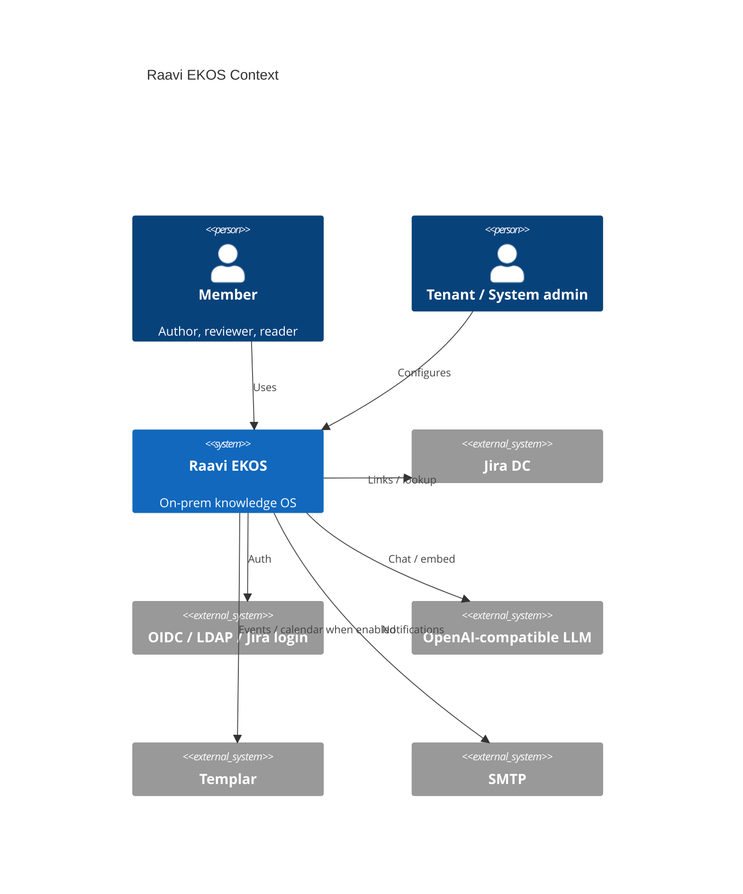
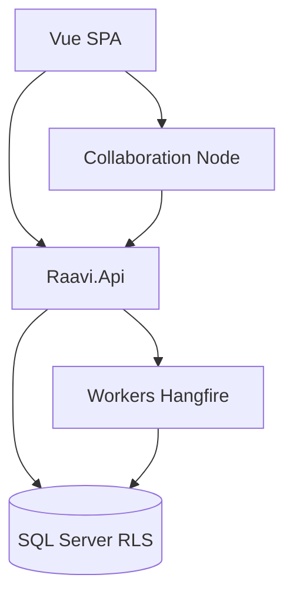

# Target Architecture

## C4 Context

## C4 Containers (keep modular monolith)

| Container | Role |
|-----------|------|
| SPA | Knowledge UX, search, admin |
| Api | REST + SignalR; all authz |
| Workers | Index, reminders, migration, purge, webhooks |
| Collaboration | Yjs; no direct DB |
| SQL Server | SoT + RLS |

**No new deployable service for EKOS Phase 1–3** unless OpenSearch/S3 are introduced as optional infrastructure (already planned 7b/7c).

## Logical domains → projects

| Domain | Home |
|--------|------|
| Knowledge core, taxonomy, calendar, collab content types, graph edges, decisions/incidents/catalog | `Raavi.Wiki` (+ content providers) |
| Search providers, RAG, Prompt Hub, AI tools/agents seams | `Raavi.AI` (+ Wiki via abstractions) |
| Connectors, webhooks, page-issue links | `Raavi.Integrations` |
| OpenSearch adapter | `Raavi.Search` when 7c unlocked |
| Identity / tenancy | existing modules |

## Cross-cutting

- **Authz:** extend `WikiAuthorizer` / `IPermissionEvaluator`; asset-type hooks, not a second ACL product  
- **Events:** extend `WikiEventTypes` + integrations outbox; versioned payloads; idempotent handlers  
- **Search ACL:** always `IViewableContentFilter` (and future OpenSearch ACL tokens)  
- **Config:** sandbox + `RAAVI_*` only  

## Anti-goals

Microservices mesh; second wiki DB; graph DB in Phase 1–3; TipTap Pro / PrimeVue 5; email-based identity merge.