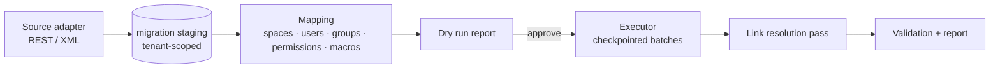

# Confluence Migration

A first-class administrative module (`Raavi.Migration`, UI at `/admin/migrations/confluence`). Highest-priority requirement: **preserve every available page version** with its content, author, timestamp and version comment.

## 1. Sources

| Source | When | Notes |
|---|---|---|
| REST API (Server/Data Center) | Live source reachable from the Raavi network | Version-specific adapters. Content: `/rest/api/content?spaceKey=…&type=page&status=current`, children/ancestors, `…/content/{id}?status=historical&version=N&expand=body.storage,version,history`, version listing (`/rest/experimental/content/{id}/version` on older 6.x/7.x builds, `/rest/api/content/{id}/version` where available — detected at runtime), attachments (`/child/attachment` + download), labels, comments, space permissions (where exposed; otherwise via XML) |
| Site XML backup (`entities.xml` + `attachments/`) | Full history incl. permissions and restrictions; source offline | Streamed with `XmlReader` (DTD prohibited, no resolver). Hibernate object graph → staging tables → neutral model. Attachments resolved from the archive's directory structure (`attachments/{contentId}/{attachmentId}/{version}`) — layout verified per Confluence version. |
| Space XML export | Single spaces | Same reader; verify per version that historical versions are included. |
| Confluence Cloud (future) | | v2 REST API adapter; designed for, not implemented. |

The adapter **detects** edition, version and build (`/rest/applinks/1.0/manifest` or `/rest/api/settings/systemInfo` where present; `exportDescriptor.properties` for XML) and selects the matching adapter. Unknown versions → explicit error with the detected values, never a guess.

## 2. Pipeline

1. **Source configuration** — URL, edition, version (auto-detected and confirmed), auth (PAT/Basic for a migration service account over TLS — credentials encrypted with the tenant data key), or archive path (uploaded to object storage or a server-side path allow-listed in global config). Connection test via SSRF-guarded client.
2. **Discovery** — spaces, page tree, versions, attachments (+ versions), comments, labels, users, groups, permissions, restrictions → counts and sizes into staging. Resumable.
3. **Destination** — the destination tenant is fixed at job creation by the tenant context of the admin who creates it (tenant admin) or explicitly chosen and audited by a system admin on the system host. The job row stores `TenantId`; every executor batch runs in a `TenantJobContext` for that tenant and RLS rejects anything else.
4. **Mapping** — Spaces (create/merge, key collisions), users (by mapped identity provider + Confluence `userKey`; e-mail as suggestion only, requires admin confirmation), groups, permission conversion (with warnings), macro registry selection.
5. **Dry run** — runs discovery + conversion into staging only and produces the report: spaces, pages, versions, attachments (count + bytes), users, groups, comments, unsupported macros (by name and count), unsupported content, mapping conflicts, permission warnings, estimated storage. No tenant production tables touched (staging is a separate schema with its own cleanup).
6. **Execution** — Hangfire job per space, batches of N pages; for each page all versions oldest → newest; attachments streamed source → object storage (never buffered fully in memory); progress (current operation, totals, completed, failed, warnings) persisted and pushed via SignalR; pause/cancel between batches; retry of failed items; checkpoints after every batch.
7. **Link resolution** — after all pages exist, rewrite `ri:page`/`ri:attachment`/`ri:space` references and URLs (`/display/KEY/Title`, `/pages/viewpage.action?pageId=…`, tiny links `/x/…`) through `MigrationSourceMappings`; unresolved → `PageLinks` with unresolved target + warning.
8. **Validation** — counts per space (pages, versions, attachments), hierarchy comparison (parent of each page), content hash comparison for the converted current version (re-convert + hash), attachment SHA-256 vs source size, unmapped users, failed records → final report (downloadable, stored with the job).

## 3. History preservation

For each source page: every available version becomes a `PageVersions` row with `VersionType=Import`, `VersionNumber` = Raavi sequence (1..n in source order), `SourceSystem='confluence'`, `SourceVersionIdentifier` = Confluence version number (and content id of the historical entity for XML), original `CreatedAt`, author mapped (`CreatedBy`) or preserved unmapped (`SourceAuthorJson` — never an invented user), version comment → `ChangeSummary`. The current source version is also the Raavi `PublishedVersionId`. Provenance (`ContentProperties: migration.sourceId, migration.jobId, migration.sourceUrl`) is kept and shown in the UI ("Imported from Confluence").

Drafts and trashed content in the source are reported, not imported, unless the admin selects them.

## 4. Content conversion

Confluence storage format is parsed as **XML** (wrapped in a synthetic root with `ac`, `ri`, `at` namespace declarations; HTML entities mapped via a fixed table), never as HTML into the DOM. The converter walks the tree and emits Raavi Document JSON via a registry:

| Source | Raavi |
|---|---|
| `h1–h6, p, ul/ol/li, table, blockquote, pre, strong/em/u/s/code, a, br, hr` | Core nodes/marks |
| `ac:image` + `ri:attachment`/`ri:url` | `raavi.image` |
| `ac:link` (+ `ri:page`, `ri:attachment`, `ri:user`) | link / mention (resolved in link pass) |
| `ac:structured-macro name=code / noformat` | `raavi.codeBlock` |
| `info / note / warning / tip / panel` | `raavi.panel` |
| `expand` | `raavi.expand` |
| `status` | `raavi.status` |
| `toc` | `raavi.toc` |
| `include`, `excerpt-include`, `excerpt` | `raavi.include`, `raavi.excerpt` |
| `jira` | `raavi.jira` (needs Jira integration; else smart link) |
| `ac:task-list` | task list |
| `ac:emoticon` | emoji |
| draw.io / Gliffy / PlantUML | attachment preview + `raavi.unsupported` (Mermaid conversion not possible in general) |
| anything else | `raavi.unsupported` with macro name, parameters and raw source kept as **escaped text**; warning recorded |

The resulting JSON is validated by the editor schema registry before persisting. Imported content is never trusted: no raw HTML, scripts, iframes or styles pass through.

## 5. Identity and permissions

- Users: mapped by Confluence `userKey` → Raavi user via the chosen mapping strategy (identity provider subject, LDAP/AD attribute, manual CSV). E-mail match is only a suggestion requiring confirmation.
- Groups → tenant groups (create or map).
- Space permissions → Raavi space grants; page view/edit restrictions → `ContentRestrictions`.
- **Never widen access:** when a restriction cannot be represented (e.g. unmapped user/group in a view restriction), the page is imported **restricted to space administrators** and a warning is raised. Anonymous access in the source is not carried over unless the tenant policy allows public access and the admin opts in.

## 6. Idempotency and resume

- `MigrationSourceMappings` unique on `(TenantId, MigrationSourceId, SourceObjectType, SourceObjectId, SourceVersionIdentifier)`; every write checks/creates the mapping in the same transaction as the destination row → re-running a batch cannot duplicate pages, versions or attachments.
- Checkpoints store the last completed source cursor per space and phase. After a crash, the job resumes from the checkpoint.
- Attachment uploads use deterministic object keys from the mapping id; re-upload overwrites the same key.

## 7. Performance

Streaming readers, batched inserts (`SqlBulkCopy` on a tenant-scoped connection), parallelism per space with a global concurrency cap, throttling for REST sources (configurable requests/second, `429` back-off), search indexing deferred to the end (bulk reindex job).

## 8. Open items

- Verify REST version-history endpoints and XML attachment layout against the customer's actual Confluence version (Q2).
- Decide whether comments' historical versions are imported (default: latest body + original author/time).
